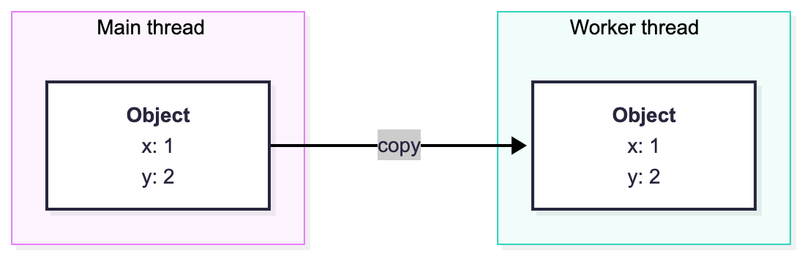
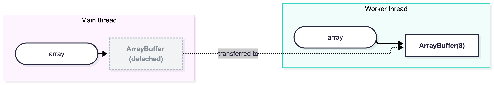
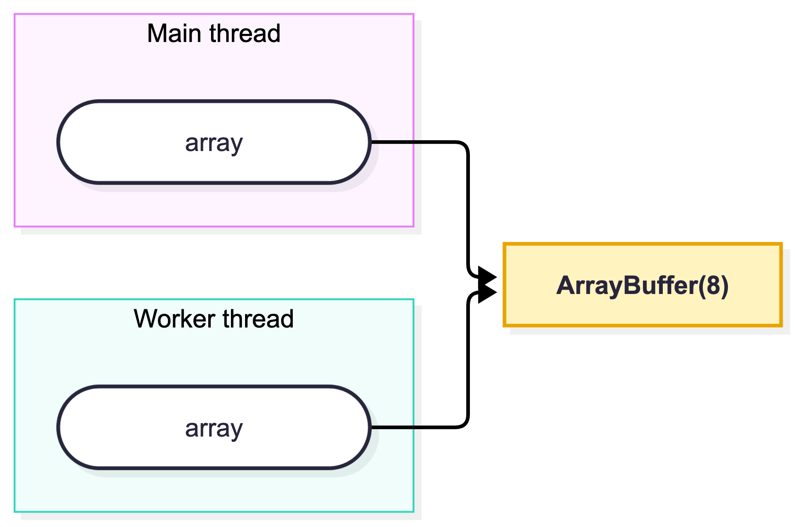
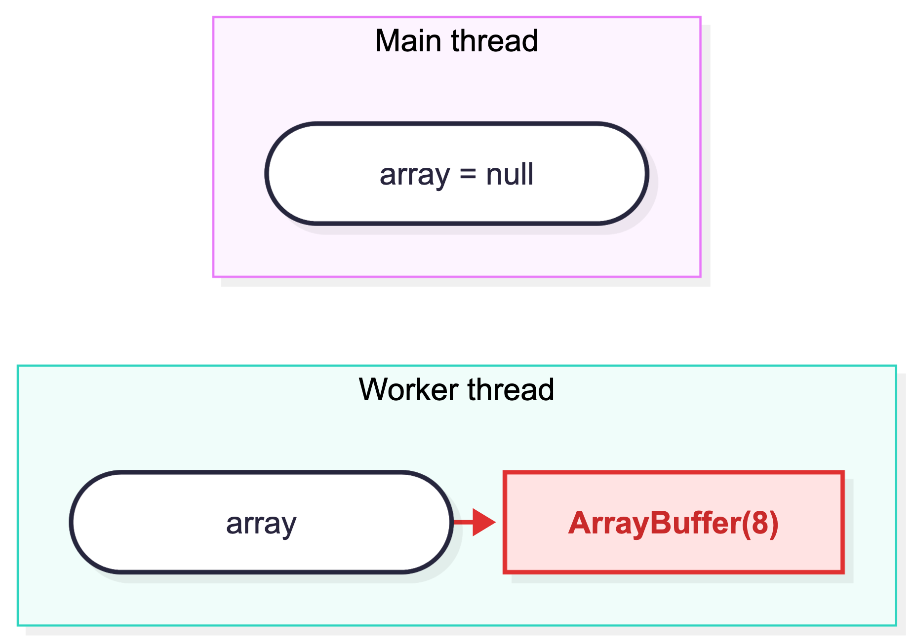

# はじめまして！ 👋😄

- [山本悠滋](https://github.com/igrep) ([\@igrep](https://github.com/igrep))
- Wasm とプリキュアとポムポムプリンと音ゲーが大好き
- 趣味では自作言語を作ったり、
- [MDN の翻訳ミートアップ](https://mozilla.doorkeeper.jp/)に参加したり、
- 仕事では [MagicPod](https://magicpod.com/) という会社でいろいろバグを直したりしています。
- igrep.el という Emacs プラグインがありますが無関係です！

# 📝今日話すこと

- 🔁「オブジェクトの所有権」は、
    - 異なる環境間で、
    - 情報を安全かつ高速に、
    - やり取りするための重要なアイディア
- 📮すでに `postMessage` というブラウザーの API や、
- ⚙️[WebAssembly Component Model](https://component-model.bytecodealliance.org/) という仕様で使われており、
    - 🌐ブラウザーはそれをサポートするつもりらしいので、
- ❣️今後ますます重要な知識になるはず！

# 📝アジェンダ

1. 所有権に入る前に...
    - `postMessage` とは？
    - 普通に `postMessage` でオブジェクトをやり取りしよう
    - 今度は Wasm Component Model でもオブジェクトをやり取りしよう
2. 所有権とは？
3. 所有権を移動させるとどうなる？
4. 所有権を移動させないとどうなる？

# 所有権に入る前に...

[`postMessage`](https://developer.mozilla.org/ja/docs/Web/API/Window/postMessage)とは:

- JavaScript のオブジェクトを異なるスレッド<small>（などの）</small>間で**安全に**やり取りするための API

# 普通に `postMessage` でオブジェクトをやり取りしよう

```html
<html>
<script>
  // メインスレッド
  const worker = new Worker("worker.js");
  worker.postMessage({ x: 1, y: 2 });
</script>
....
```

```js
// worker.js
onmessage = (event) => {
  const { x, y } = event.data;
  console.log("Received:", x, y);
};
```

# `postMessage` によるオブジェクトのやり取り

<!--

const data = { x: 1, y: 2 };
worker.postMessage(data);

-->

<!--

onmessage = (event) => {
  const copied = event.data;
  console.log("Received:", copied.x, copied.y);
};

-->

<!--
flowchart LR

subgraph T_worker["Worker thread"]

o0["<b>Object</b><br/>x: 1<br/>y: 2"]
end

subgraph T_main["Main thread"]

o1["<b>Object</b><br/>x: 1<br/>y: 2"]
end

o1 -. copy .-> o0

style T_main fill:#fdf4ff,stroke:#e879f9
style T_worker fill:#f0fdfa,stroke:#2dd4bf
-->

<!--
https://mermaid.live/edit#pako:eNqVj8tqwzAQRX9FTLaOK_lR2yJk02xLN4FCo1JkaxS7sSWjyCRuyL-XuE0K2XV3ZzhzLnOCyioEDrq1h6qWzpP1Shhh9kO5dbKvyfrjYN0O3UbA6xSIrx1KJeD9wlm6EbAoly_lJ1Z-8VAuF6V7WB45YVMYOYkmFI2683ayMRsBz7Ixd072P6dlZB6SyvYjCedLYulU5McWf1uIbtqWz7TSidbB3ju7Qz7DPCt08Uf-_HllqVZa3thIqaTUEMDWNQq4dwMG0KHr5GWEkzCECPA1diiAEwEO1XCcV7a1ToAwZwigl-bN2u567eywrYFr2e4xgKFX0uOqkVsnu9vWoVHonuxgPHCWZpME-AmOwIsoTKPHmMVZzrI4j_IARuBxErI0LpKI0ZylSXwO4GsqpWGepZRSmmTFhYiK8zfV4qTO
-->

オブジェクトを**コピー**してやり取りする



<!-- なぜか mermaid.live で書き出した SVG が、一部しか表示されない -->

# Wasm Component Model でもオブジェクトをやり取りしよう

... その前に....

# 🤔Wasm Component Model とは？

- WebAssembly (Wasm) の仕様として、
- 「Component Model ABI」に従った「Wasm Component」という種類の`.wasm`ファイルを作ると、
- お互いの関数にお互いのオブジェクトを渡して呼び合えるようになる
    - 違う言語で作られた Wasm Component 同士でも 🆗！
    - ホスト<small>（Wasm を使うアプリ）</small>と Wasm とが関数を呼び合うのも 🆗！
    - FFI とかよりも安全で楽ちん！

# 🤔Wasm Component Model とは？（続き）

- 現状まだ Phase 1。
    - でも `jco`、`componentize-py` などのツールを使えば一応使える
- ブラウザーに入ると、JS 以外の言語からブラウザーの API を呼ぶのが簡単に！
    - ✨**顧客が本当に欲しかったもの！**✨
    - 参考: [Why is WebAssembly a second-class language on the web?](https://hacks.mozilla.org/2026/02/making-webassembly-a-first-class-language-on-the-web/)

# Wasm Component の例

詳細は[リポジトリー](https://github.com/igrep/wasm-component-example/tree/main/simple)を参照！

```wit
// example.wit

world example {
  export greet: func(caller: string) -> string;
}
```

# Wasm Component の例（続き）

```py
# python.py
import sys

class WitWorld():
  def greet(self, caller: str) -> str:
    version = sys.version_info
    major = version.major
    minor = version.minor
    micro = version.micro
    return f"Hello, {caller}! I'm Python {major}.{minor}.{micro}!"
```

# Wasm Component の例（続き）

[`componentize-py`](https://github.com/bytecodealliance/componentize-py) で Wasm Component を作り、[jco](https://github.com/bytecodealliance/jco) で ESM に変換する:

```sh
$ componentize-py \
  -d example.wit \
  -w example \
  componentize \
  python \
  -o python.wasm
$ jco transpile python.wasm -o out-python
```

# Wasm Component の例（続き）

実行例:

```js
import { greet } from "./out-python/python.js";

console.log(greet(`Node.js ${process.version}`));
```

結果:

```sh
$ node simple/index.js
Hello, Node.js v26.7.0! I'm Python 3.14.0!
```

# ここまでのまとめと補足

- `postMessage` も Wasm Componend Model も、異なる環境間でオブジェクトをやり取りするための仕組み
- Wasm Component Model は、ブラウザーが実装したら JS 以外の言語からブラウザーの API を呼ぶのが簡単になる！
- ここまで紹介した例では、いずれもオブジェクトを**コピー**してやり取りする
- ここからは、「所有権の移動」という、コピーとは異なったアプローチを紹介します！

# 所有権とは

*️⃣このスライドにおける定義

- あるオブジェクト<small>（プログラムが扱うデータ）</small>がどの**環境**に属しているかを示す概念
- そのオブジェクトを使えるのは、属している環境だけ
    - 所有権を**移動**させると、移動先の環境でオブジェクトが使えるようになる代わりに、元の環境では使えなくなる

# 環境とは

*️⃣これもこのスライドにおける定義

プログラム（と、そのパーツ。スレッドやモジュール）がアクセスできるメモリー内のデータの集まり

```js
// モジュール（がアクセスできる変数）の環境
import { imported } from "some-module.mjs";
const x = "hello";

function f() {
  // 関数（がアクセスできる変数）の環境
  const y = "world";
  console.log(imported, x, y);
}
```

# `postMessage` における所有権の移動

```js
// メインスレッド（UI スレッド）
const array = new ArrayBuffer(8);
console.log(array.byteLength);
// ここで `array` の所有権を `worker` に移動させる
worker.postMessage(array, { transfer: [array] });
console.log(array.byteLength);
```

# `postMessage` における所有権の移動（続き）

```js
// worker.js
onmessage = (event) => {
  const array = event.data;
  console.log(array);
};
```

# `postMessage` における所有権の移動（続き）

<iframe src="/works/sharing-simulator/embedded.html?mode=transfer&main=++const+array+%3D+new+ArrayBuffer%288%29%3B%0A++console.log%28array.byteLength%29%3B%0A++worker.postMessage%28array%2C+%5Barray%5D%29%3B%0A++console.log%28array.byteLength%29%3B%0A&worker=let+array+%3D+null%3B%0Aonmessage+%3D+%28e%29+%3D%3E+%7B%0A++array+%3D+e.data%3B%0A++console.log%28array%29%3B%0A%7D%3B%0A&tab=console" width="100%" height="120"></iframe>

- `worker.postMessage(array, { transfer: [array] })` で `array` の所有権を移動すると...
    - メインスレッドでは`array`の中身が空になり、 `byteLength` が `0`になる
    - Worker スレッドでは`array`の中身がそのまま使える

# `postMessage` における所有権の移動（続き）

イメージ:



# どんなオブジェクトを移動させないといけないのか

- 🐢コピーするには時間がかかる<small>（かかり過ぎる）</small>オブジェクト
    - 例: サイズが大きな `ArrayBuffer` とか
- 💥1つのスレッドが占有しないとデータが競合してしまうオブジェクト
    - 例: [`MessagePort`](https://developer.mozilla.org/ja/docs/Web/API/MessagePort) とか、[`OffscreenCanvas`](https://developer.mozilla.org/ja/docs/Web/API/OffscreenCanvas) とか
    - ⚠️複数のスレッドで共有するとすごく危険

# Wasm Component Model における所有権の移動

wa(\_ \_)sm

- 時間がないので[この間の Fukuoka.wasm でのスライド](/slides/2026-11-12-fukuoka.wasm.html)や、
- そこでの[サンプルコード](https://github.com/igrep/wasm-component-example/tree/main/resource)をご覧ください

# なぜ移動させないといけないのか

<!--
各種プログラミング処理系 --- コンパイラーやインタープリター --- がそれぞれのメモリー管理機構を備えている通り、それぞれのアプリケーションが実行される際にできる、「環境」にはそれぞれのメモリー管理機構がある。
-->

- 「環境」にはそれぞれのメモリー管理機構がある
    - 各種 GC（ガベージコレクター）だったり、
    - 参照カウンターだったり、
    - Rust のような、コンパイル時に所有権をチェックすることで、必要な箇所に割り当てたり解放したりするコードを挿入する仕組みだったり、
        - （いわゆる所有権システム）
    - C のようにアプリケーションに必要な API を提供するだけの仕組みも。
        - いわゆる手動管理

# なぜ移動させないといけないのか（続き）

- それぞれのメモリー管理機構は、他の環境のメモリー管理機構のことを知らない
    - 🙈環境間でオブジェクトを<small>（中身をコピーしないで）</small>やり取りする場合は、所有権を移動させることで、対象のオブジェクトを「もう管理しない」ことにする必要がある

# JavaScript の場合...

メインスレッド（UI スレッド）と Worker スレッドも、それぞれ独立した「環境」で動く

<small>理由（私の想像）</small>

- 歴史的に JavaScript は UI スレッドでのみ動く前提で作られている
    - UI スレッドをマルチスレッドにするのはほぼ無理ゲーであることが知られているので...
        - [参考: Wikipedia](https://ja.wikipedia.org/w/index.php?title=%E3%83%A6%E3%83%BC%E3%82%B6%E3%83%BC%E3%82%A4%E3%83%B3%E3%82%BF%E3%83%BC%E3%83%95%E3%82%A7%E3%82%A4%E3%82%B9%E3%82%B9%E3%83%AC%E3%83%83%E3%83%89&oldid=107237451)
- Worker も UI スレッドに倣って1つの Worker につき1つのスレッドで動くよう設計された
    - シンプルで、マルチスレッドのハマりどころも回避しやすい！
- もし UI スレッドと Worker スレッドを同じ「環境」にしてしまうと、マルチスレッドを考慮した GC を作らないといけない

<br /> <!-- Sldy の バグなのか何なのか、スライドの内容量が多すぎて画面をはみ出ると端が切れてしまう問題に対するworkaround -->

# 移動させなかったらどうなる？

所有権を侵害したやり取りのシミュレーションをします

- *もし `postMessage` の `transfer` オプションがオブジェクトの所有権を移動させなかったら*
    - ⚾長いのでここからは「もしtra」と呼びます
    - 🙃略したらたまたまそうなっただけです。古いネタですみません...

# もしtra

```js
// メインスレッド（UI スレッド）
const array = new ArrayBuffer(8);
console.log(array.byteLength);
// `transfer` オプションを指定しているのに所有権が移動しなかったら...
worker.postMessage(array, { transfer: [array] });
console.log(array.byteLength);
```

# もしtra（続き）

```js
// worker.js
onmessage = (event) => {
  const array = event.data;
  console.log(array);
};
```

# もしtra（続き）

実行結果:

<iframe src="/works/sharing-simulator/embedded.html?mode=share&main=++const+array+%3D+new+ArrayBuffer%288%29%3B%0A++console.log%28array.byteLength%29%3B%0A++worker.postMessage%28array%2C+%7B+transfer%3A+%5Barray%5D+%7D%29%3B%0A++console.log%28array.byteLength%29%3B%0A&worker=let+array+%3D+null%3B%0Aonmessage+%3D+%28e%29+%3D%3E+%7B%0A++array+%3D+e.data%3B%0A++console.log%28array%29%3B%0A%7D%3B%0A&tab=console" width="100%" height="120"></iframe>

😕一見問題なさそう？

# もしtra（続き）

図にするとこんな感じ:



# もしtra（危険なケース）

```js
// メインスレッド（UI スレッド）
let array = new ArrayBuffer(8);
worker.postMessage(array, { transfer: [array] });
// メインスレッドで array をもう使わないつもりで null にする
array = null;
// この後 GC が走ると、メインスレッドの `ArrayBuffer` は解放される
```

# もしtra（危険なケース 続き）

```js
// worker.js
onmessage = (event) => {
  const array = event.data;
  console.log(array);
};
```

（こちらは先ほどと同じ）

# もしtra（危険なケース 続き）

Worker スレッドが、存在しない `ArrayBuffer` への参照を持ってしまう！:



# もしtra の何がまずい？

- メインスレッドの GC は、Worker スレッドがどのオブジェクトを参照しているか知らない
    - 🧹例えば Worker スレッドがメインスレッドの `ArrayBuffer` を使っていても、メインスレッドの GC が勝手に解放してしまう
    - ➡️💥 **Use after free**!!
        - 解放後のメモリーを使用することによって、プログラムをおかしな方向に動作させるバグ
        - PHP2Shell で発生するのもこれ
- これを回避するために、所有権を移動させる

# 📝まとめ

- `postMessage` も Wasm Componend Model も、異なる環境間でオブジェクトをやり取りするための仕組み
- 環境をまたいでオブジェクトをやり取りするには、コピーするか、所有権を移動させる
- 所有権の移動は、
    - オブジェクトのコピーよりも高速で、
    - [`OffscreenCanvas`](https://developer.mozilla.org/ja/docs/Web/API/OffscreenCanvas)のような、1つの環境が占有する前提のオブジェクトのやりとりも可能にする
    - 移動させた後は元の環境では使えなくなるので注意
        - もし移動させなかったら、（例えば）元の環境の GC が勝手に解放してしまい、移動先の環境が解放済みのオブジェクトを使ってしまう、などの危険がある

<br /> <!-- Sldy の バグなのか何なのか、スライドの内容量が多すぎて画面をはみ出ると端が切れてしまう問題に対するworkaround -->

# 参考（本文中に言及がなかったもののみ）

- [component-model/design/mvp/Explainer.md at main · WebAssembly/component-model](https://github.com/WebAssembly/component-model/blob/a25fc0b372dd21f07f0242c46e98bd0f1ea0c0e1/design/mvp/Explainer.md)
- [component-model/design/high-level/Choices.md at main · WebAssembly/component-model](https://github.com/WebAssembly/component-model/blob/main/design/high-level/Choices.md)
- [Runtime system - Wikipedia](https://en.wikipedia.org/wiki/Runtime_system)
- [移譲可能オブジェクト - Web API | MDN](https://developer.mozilla.org/ja/docs/Web/API/Web_Workers_API/Transferable_objects)
- [所有権とは？ - The Rust Programming Language 日本語版](https://doc.rust-jp.rs/book-ja/ch04-01-what-is-ownership.html)
- [Google AI 検索での質問](https://www.google.com/search?smstk=ChhDd04zNElNRnVKV2orS29oTitsQUJadz0QARgA&smstidx=0&q=According+to+https%3A%2F%2Fdeveloper.mozilla.org%2Fen-US%2Fdocs%2FWeb%2FAPI%2FWeb_Workers_API%2FTransferable_objects%2C+transferring+objects+instead+of+copying+them+ensures+that+the+resources+are+only+available+in+one+context+at+a+time.+I%27m+asking+about+the+merit+of+ensuring+the+object%27s+uniqueness.+I+know+avoiding+copying+objects+for+speed+is+one+of+them.+Anything+else%3F&udm=50&csuir=1&aep=34&kgs=e71251f405a0ff86&shem=agpl%2Caiolsbe%2Casdpe%2Casple%2Cepsd1%2Cesd2e%2Crimspwouoe%2Csdpie&shndl=37&shmd=H4sIAAAAAAAA_3WQsW4UMRCGCaKI0iClpBqliYTImjQUKFJ0ZbpIgFJas_ac19zas5nx5u6o8iq8Bc_AW_Am2MdehVJZ88v___0zZz_fnP15vXKOxcccoDAMpUz62RhPTzTyRNIl_hHHETuWYChffftiPDs1D9Sb1f1de-0Dy4ZEbZu_CmZdk2A_kuX-O7miH6AsqjTMokLMWgg98BocT_tDg4ESUNZZSOuApSlQB57FVQmFgPO4B3zCODZGTakK1YRcaFegWhBKTNTB3WUC1E3LxZ7nf1mJJJaGPFAW5lLpUmHO8XGmTKrVD5vM24rieDjPseSx_5oFdCLyEPXQoaa2BTpY5X0Z2lcalW7f3Ryvut1uu6AFS3Sd42SUUNxwNQknNhiT1aFuaMswpz7XBbsph4vzozswh5E6jOb9q93z2-eTX6e_T-xL2TFhIDV9vXxrv7iDDYI-Ui7mevefZqs_exRvrz999FPD_wUTMw4aJAIAAA&shmds=v1_ARwrE20gOw_tjVTJW-DJyw5DuSCq0MfrQ-Y8yav2uLTXX2RKzw&source=sh%2Fx%2Faim%2Fm1%2F1&mtid=Ojn-arugOqPS2roPiKbxsQg)
- [Feature Status - WebAssembly](https://webassembly.org/features/)
- [The Road to Component Model 1.0](https://bytecodealliance.org/articles/the-road-to-component-model-1-0)
- [PHPの重大な脆弱性「php2shell」（CVE-2026-109618、CVE-2026-109619）の概要と対応指針 - GMO Flatt Security Blog](https://blog.flatt.tech/entry/php2shell)

<br /> <!-- Sldy の バグなのか何なのか、スライドの内容量が多すぎて画面をはみ出ると端が切れてしまう問題に対するworkaround -->
